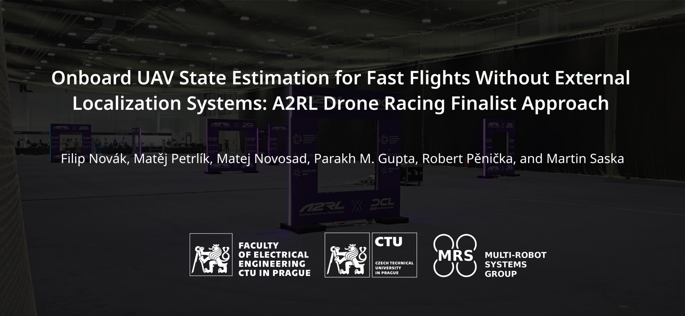

    <h1>Onboard UAV State Estimation for Fast Flights Without External Localization Systems</h1>
        <a href="https://mrs.fel.cvut.cz/filip-novak" target="_blank">Filip Novák</a>,
        <a href="http://mrs.fel.cvut.cz/members/postdocs/matej-petrlik" target="_blank">Matěj Petrlík</a>,
        <a href="https://mrs.fel.cvut.cz/members/phdstudents/matej-novosad" target="_blank">Matej Novosad</a>,
        <a href="https://mrs.fel.cvut.cz/members/phdstudents/parakh-gupta" target="_blank">Parakh M. Gupta</a>,
        <a href="https://mrs.fel.cvut.cz/members/professors/penicka" target="_blank">Robert Pěnička</a>, and
        <a href="https://mrs.fel.cvut.cz/members/martin-saska" target="_blank">Martin Saska</a>
        

            <h48>
                                
                  
                 
            </h8>
        

        
        
     
     

This repository contains the open-source implementation of our paper titled 'Onboard UAV State Estimation for Fast Flights Without External Localization Systems: A2RL Drone Racing Finalist Approach'.

## Abstract
Fast flights with aggressive maneuvers in cluttered GNSS-denied environments require fast, reliable, and accurate UAV state estimation.
In this paper, we present an approach for onboard state estimation of a high-speed UAV using a monocular RGB camera and an IMU.
Our approach fuses data from Visual–Inertial Odometry (VIO), an onboard landmark-based camera measurement system, and an IMU to produce an accurate state estimate.
Using onboard measurement data, we estimate and compensate for VIO drift through a novel mathematical drift model.
State-of-the-art approaches often rely on more complex hardware (e.g., stereo cameras or rangefinders) and use uncorrected drifting VIO velocities, orientation, and angular rates, leading to errors during fast maneuvers.
In contrast, our method corrects all VIO states (position, orientation, linear and angular velocity), resulting in accurate state estimation even during rapid and dynamic motion.
Our approach was thoroughly validated through 1600 simulations and numerous real-world experiments.
Furthermore, we applied the proposed method in the A2RL Drone Racing Challenge 2025, where our team advanced to the final four out of 210 teams and earned a medal.

## License
AGPL-3.0 License. Copyright (C) 2026 F. Novák, M. Petrlík, M. Novosad, P. M. Gupta, R. Pěnička, M. Saska (Faculty of Electrical Engineering, Czech Technical University in Prague).

This is a research code, expect that it changes often and any fitness for a particular purpose is disclaimed.

