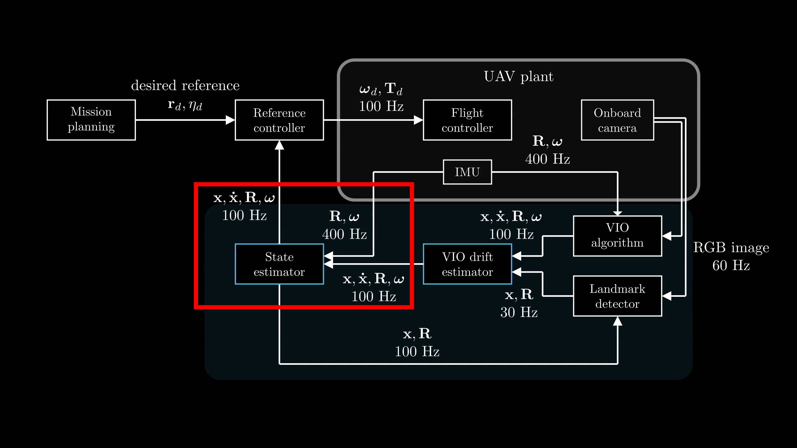

# Corrected VIO State Estimator
This package implements an Estimator plugin for the MRS UAV System to incorporate drift-corrected VINS/VIO odometry provided by the [VINS Drift Estimator](https://github.com/ctu-mrs/onboard-uav-state-estimation-a2rl/tree/master/packages/vins_drift_estimator). 



## How to use it?
Load it dynamically into the MRS UAV System via a custom config as an [Estimator plugin](https://ctu-mrs.github.io/docs/plugin-interface/estimators).

```yaml
mrs_uav_managers:
  
  estimation_manager:
    state_estimators: [
     "corrected_vio",
    ] 
    corrected_vio:
      address: "mrs_uav_state_estimators/CorrectedVio"  
      max_flight_z: 100.0 # [m] maximum allowed flight Z (in the estimator frame)
      kickoff: false # do not wait until desired Hz is achieved
      message:
        topic: "vins_drift_estimator/corrected_odom"

  constraint_manager:
    estimator_types: [
      "corrected_vio",
    ]
    constraints: [
      "slow",
      "medium",
      "fast"
    ]
    # list of allowed gains per odometry mode
    allowed_constraints:
      corrected_vio: ["slow", "medium", "fast"]
    # those gains will be used automatically when a localization mode switches
    # and the current gains are not in the allowed list (next paragraphs)
    default_constraints:
      corrected_vio: "slow"
    
  gain_manager:
    estimator_types: [
      "corrected_vio",
    ]
    gains: [
      "racing"
    ]
    # list of allowed gains per odometry mode
    allowed_gains:
      corrected_vio: ["racing"]
    # those gains will be used automatically when a localization mode switches
    # and the current gains are not in the allowed list (next paragraphs)
    default_gains:
      corrected_vio: "racing"
  
  transform_manager: 
    corrected_vio:
      odom_topic: "odom" # name of the topic (expects nav_msgs/Odometry topic type)
      tf_from_attitude: # used for transforming velocities before full transform is available
        enabled: false
      namespace: "estimation_manager/corrected_vio" # the namespace of the topic (usually the node that publishes the topic)
      utm_based: false # if true, will publish tf to utm_origin
      inverted: true # publish as inverted tf (the default for inverted mrs tf tree convention)
      republish_in_frames: [] # the odometry message will be transformed and republished in the specified frames
    
```

## License
AGPL-3.0 License. Copyright (C) 2026 F. Novák, M. Petrlík, M. Novosad, P. M. Gupta, R. Pěnička, M. Saska (Faculty of Electrical Engineering, Czech Technical University in Prague).

This is a research code, expect that it changes often and any fitness for a particular purpose is disclaimed.

