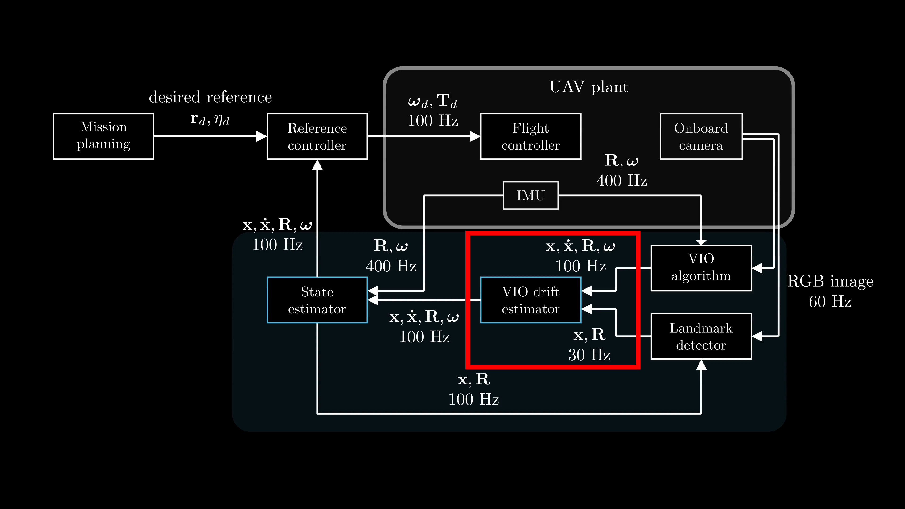

# VINS Drift Estimator 
This package implements an estimator that fuses VINS/VIO odometry with landmark detector measurements and IMU data to estimate VINS/VIO drift, which is then used to correct the VINS/VIO odometry and publish drift-corrected odometry.

## License
AGPL-3.0 License. Copyright (C) 2026 F. Novák, M. Petrlík, M. Novosad, P. M. Gupta, R. Pěnička, M. Saska (Faculty of Electrical Engineering, Czech Technical University in Prague).

This is a research code, expect that it changes often and any fitness for a particular purpose is disclaimed.

